# Cross-validation

Cross-validation sends the **same request** to multiple RPC nodes in parallel and requires **agreement** before it returns the response. Use it to catch a single lying or buggy node before bad data reaches your client.

Cross-validation is also called *consensus*. This page uses the two terms for the same thing.

## How it works

When cross-validation is active for a relay:

1. Smart Router sends the request to `MaxParticipants` nodes in parallel.
2. Responses are collected as they arrive.
3. As soon as `AgreementThreshold` nodes return matching responses, that response is returned.
4. If nodes still disagree when the timeout passes, the relay fails or returns the most-agreed answer (depending on configuration).



| Parameter | Meaning |
|---|---|
| `MaxParticipants` | how many nodes to query in parallel |
| `AgreementThreshold` | how many must match before the response is accepted |

The default values are `{MaxParticipants: 1, AgreementThreshold: 1}`, which in effect disables it. Cross-validation is opt-in per relay, not always on, because it multiplies upstream cost.

## When to use it

| Scenario | Cross-validate? |
|---|---|
| Critical writes (token transfers, contract calls) | yes, but check responses, not just submission acks |
| Indexer-style reads of finalized data | optional; the cache hit rate already absorbs most of the cost |
| `eth_getLogs` results that downstream code depends on | yes; nodes often disagree on log ordering |
| `debug_*` traces | yes, if you do not trust a single node |
| `eth_call` against contracts at fixed block | yes; deterministic and easy to compare |
| `eth_call` against pending block | no; non-deterministic by definition |
| `eth_blockNumber` / latest block reads | no; nodes naturally disagree by 1 block |

## Configuration

You can turn on cross-validation in two ways. The router combines them for each request in [`cross_validation_policy.go`](https://github.com/Magma-Devs/smart-router/blob/main/protocol/rpcsmartrouter/cross_validation_policy.go):

**1. Per-request, by the client.** Send both headers and the router cross-validates that single request:

```
lava-cross-validation-max-participants: 3
lava-cross-validation-agreement-threshold: 2
```

See [Directives](../../api/directives.md). The router reports the outcome in the response headers (`lava-cross-validation-status`, `lava-cross-validation-agreeing-providers`, and on failure `lava-cross-validation-failure-reason`).

**2. Operator policy.** An operator can **mandate** cross-validation for a `(chain, interface, method)`, with floors and caps, or **forbid** clients from requesting it for a method. Policies go in a top-level `cross-validation` block in the [smart router config file](../config-file.md#cross-validation):

```yaml
cross-validation:
  policies:
    # Mandate consensus for a sensitive read, capped so clients can't fan out wider.
    - chain-id: "ETH1"
      api-interface: "jsonrpc"
      method: "eth_getLogs"
      enabled: true
      agreement-threshold: { floor: 2 }
      max-participants: { floor: 3, cap: 5 }
    # Forbid clients from cross-validating a non-deterministic method.
    - chain-id: "ETH1"
      api-interface: "jsonrpc"
      method: "eth_blockNumber"
      forbid-caller-cv: true
```

When an enabled policy applies, each setting is `clamp(caller-or-floor, floor, cap)`. A client may *raise* `MaxParticipants` above the floor, but cannot shrink the quorum below the operator's minimum. `forbid-caller-cv` turns off cross-validation for the method, even when a client sends the headers. It cannot be combined with `enabled`. See the [config-file reference](../config-file.md#cross-validation) for the full field list.

Each bound takes `{ floor, cap }`. A **bare number** is shorthand for a floor with no cap: `agreement-threshold: 2` is the same as `agreement-threshold: { floor: 2 }`. Use it for the common "mandate at least N, no upper bound" case.

### Group diversity

Group-diversity policies require the quorum to span multiple **independent** operator groups. Nodes that all share a vendor, image or data source can agree on the *same wrong answer*, so a plain count of agreeing nodes can hide a correlated fault.

Groups come from the `group-label` you set on each provider in the config file (e.g. `tier-1`, `external`, a vendor name). See [`group-label`](../config-file.md#direct-rpc-upstream-nodes) under `direct-rpc`. Providers with no label all go into one default group. Two policy fields act on these groups:

| Field | Meaning |
|---|---|
| `min-groups` | The agreeing nodes must come from at least this many distinct `group-label`s. |
| `per-group-quorum` | Require each of `min-groups` groups to *independently* reach `agreement-threshold` (needs `min-groups > 1`). |

```yaml
cross-validation:
  policies:
    - chain-id: "ETH1"
      api-interface: "jsonrpc"
      method: "eth_getLogs"
      enabled: true
      agreement-threshold: { floor: 2 }
      max-participants: { floor: 4, cap: 6 }
      min-groups: 2          # the quorum must span ≥ 2 distinct group-labels
      per-group-quorum: true # …and each group must independently agree
```

Diversity depends on your labels. If every upstream has the same `group-label`, `min-groups` can never be satisfied and the relay fails the policy. Label providers by how independent they really are (distinct vendors, regions or clients), not by name alone.

!!! tip "Runnable example"
    The repo includes a ready-to-run multi-chain config. It pairs two vendor groups (`lava` + `publicnode`) per chain and mandates `min-groups: 2` cross-validation on several read methods: [`config/smartrouter_examples/smartrouter_multichain_cross_validation.yml`](https://github.com/Magma-Devs/smart-router/blob/main/config/smartrouter_examples/smartrouter_multichain_cross_validation.yml).

With no operator policy, the caller's headers alone decide. With no headers and no policy, cross-validation is off (`{MaxParticipants: 1, AgreementThreshold: 1}` is in effect disabled). The `CrossValidationParams` shape is defined in [`protocol/common/types.go`](https://github.com/Magma-Devs/smart-router/blob/main/protocol/common/types.go).

## Trade-offs

- **Cost**: a request with `MaxParticipants: 3` costs 3× upstream calls. Use caching as well, so the multiplier does not apply to cache hits.
- **Latency**: the response waits for the slowest of the agreeing nodes. Combine it with [hedging](hedge.md) to reduce this.
- **Determinism**: the comparator understands the response shape (it knows that array order can be normalized for some methods, that some fields are timestamp-based, and so on). Do not expect raw byte equality.

## Difference from integrity

- [**Integrity**](integrity.md) catches *out-of-sync* nodes before the relay is sent (pre-request lag check).
- **Cross-validation** catches *wrong* responses by comparing across RPC nodes after they return.

You can run both together.

## Observability

| Metric | Meaning |
|---|---|
| `smartrouter_cross_validation_requests_total` | cross-validated requests |
| `smartrouter_cross_validation_success_total` / `smartrouter_cross_validation_failed_total` | requests that reached / failed to reach consensus |
| `smartrouter_cross_validation_provider_agreements_total` / `_provider_disagreements_total` | per-provider agreement / disagreement counts |
| `smartrouter_cross_validation_mismatch_total` | content outliers by `group` and `finality`. Divergence after finality is the most useful signal to alert on |
| `smartrouter_cross_validation_failures_total` | failures broken down by `reason` (structural vs. quorum disagreement) |
| Tracing | each fan-out attempt is a parallel span; the comparator's verdict is a span event |

See the [Metrics reference](../../reference/metrics.md#cross-validation) for labels and types.
