# Hedge

If a relay has not returned by a fixed deadline, Smart Router sends the **same request** to a second node in parallel. The first response wins, and the slower attempt is discarded.

## What it solves

Hedging reduces tail latency. With hedging off, a node that is slower than its 99th-percentile, but has not timed out yet, slows down every request that waits on it. With hedging on, the fastest of N parallel attempts cuts off the slow node's tail.

## How it triggers

A ticker in the relay state machine triggers hedges. On each tick, if no response has arrived and an attempt slot is free, the router sends a new attempt. Later ticks keep sending parallel attempts, up to the retry cap.

Hedging uses the same mechanism as retry. The only difference is *why* the next attempt is sent:

| Trigger | What it's called |
|---|---|
| Previous attempt errored | retry |
| Previous attempt is taking too long | hedge |

Both add to the same retry counter, and both are capped at 10 attempts per relay.

## When hedges win

| Scenario | Hedge helps? |
|---|---|
| One slow node, others fast | yes; the hedge skips the slow one |
| All nodes slow | no; the fastest is still slow |
| One unresponsive node | yes, but [retry](retry.md) also does this once the node errors |
| Tail latency on indexer-style heavy reads | yes; p99 improves significantly |
| Write traffic (`sendRawTransaction`) | covered by **stateful fan-out** instead. Write paths are always sent to all eligible nodes, independent of hedging |
| JSON-RPC batch requests | no; batches are not hedged by default, because a batch can carry a write. See [Batch requests](retry.md#batch-requests) |

## When to be cautious

- **Cost**: every hedge sends a real upstream request. If you run high traffic and cost matters, compare the gain from hedging with your per-call upstream price.
- **Idempotency**: hedging non-idempotent calls (writes that change state on the upstream) can cause duplicate side effects. Smart Router does not currently tell these calls apart. If your upstream protocol is non-idempotent, disable hedging or accept the risk.
- **Node rate limits**: hedging multiplies your request rate against each node. Make sure your selection policy spreads attempts across the pool.

## Configuration

The hedge tick interval is currently derived from the chain (from `average_block_time` and the per-method category). It is not a YAML setting. Hedge attempts share the 10-attempt cap with retries. See [Retry](retry.md).

## Observability

| Metric | Meaning |
|---|---|
| `smartrouter_hedge_total` | hedge (batch-ticker) relays sent |
| `smartrouter_hedge_success_total` / `smartrouter_hedge_failed_total` | hedged requests that succeeded / failed |
| `smartrouter_hedge_attempts` | histogram of hedge relays per request (buckets 1…10) |
| Tracing | each hedged attempt is a parallel span under the same parent |

See the [Metrics reference](../../reference/metrics.md#hedging) for labels and types.
