# Failover & retry

This section covers what Smart Router does when a relay goes wrong: an RPC node is slow, returns an error, or falls behind the chain head. Use it to find the policy that handles your case.

Each policy is independent, and several can act during the life of a single relay.

## Policies

| Policy | Trigger | What it does |
|---|---|---|
| [**Retry**](retry.md) | the upstream returns a retryable error | moves to a different node; tolerates `--set-relay-retry-limit` errors (default 2) |
| [**Hedge**](hedge.md) | the request has not returned within a tick | sends a parallel attempt to another node; the first response wins |
| [**Timeout**](timeout.md) | per-attempt window passes, or overall budget runs out | window: sends a hedge while the first attempt keeps running; budget: ends the relay |
| [**Integrity**](integrity.md) | a node is out of sync | a pre-request lag check skips lagging nodes before they are picked |
| [**Circuit breaker**](circuit-breaker.md) | the node pool is exhausted | stops the relay early instead of retrying forever |

To catch *wrong* data by comparing answers across nodes, see [Cross-validation](cross-validation.md). It is a related correctness control that works alongside failover.

## How they compose

The overall timeout (`--default-processing-timeout`) covers the whole pipeline. If it fires, the router returns the most useful result it has. The per-attempt window (`--min-relay-timeout` floor or `lava-relay-timeout` header) sets when the next node is tried. It does not cancel the attempt that is already in flight.

**JSON-RPC batch requests are not retried or failed over by default.** See [Batch requests](retry.md#batch-requests).

The code that runs these policies is the relay state machine in [`protocol/relaycore/unified_relay_state_machine.go`](https://github.com/Magma-Devs/smart-router/blob/main/protocol/relaycore/unified_relay_state_machine.go). The classifier that decides if an error is retryable or terminal is in [`protocol/common/error_registry.go`](https://github.com/Magma-Devs/smart-router/blob/main/protocol/common/error_registry.go). See [Error codes](../../reference/error-codes.md).

## What's tunable

Smart Router's failover settings fall into three groups:

| Group | Examples | Where tuned |
|---|---|---|
| CLI flags | `--set-relay-retry-limit`, `--default-processing-timeout`, `--min-relay-timeout` | startup args |
| Per-request headers | `lava-relay-timeout`, `lava-select-provider` | HTTP headers or gRPC call metadata. See [Request headers](../../api/directives.md) |
| Chain-derived defaults | integrity lag threshold, hedge tick | computed from the chain spec; you cannot currently set them in YAML |

If a setting cannot be tuned, the policy's page says so.

## Observability

Every policy emits Prometheus metrics on the `--metrics-listen-address` endpoint (default `:7779`). Each policy page names the metric series it emits. The full list is in the [Metrics reference](../../reference/metrics.md). OpenTelemetry traces cover the full relay lifecycle. To send them to your collector, set `OTEL_EXPORTER_OTLP_ENDPOINT`.
