# Why Smart Router?

Smart Router is a standard, actively maintained RPC proxy layer with failover, caching, and monitoring built in. Teams have built this layer in-house thousands of times, and you can use Smart Router instead.

Instead of building and maintaining your own RPC proxy, you get multi-chain support across EVM and non-EVM networks, automatic failover, data cross-validation, built-in observability, caching, and more.

## Failover

Automatic failover adds reliability when an upstream has problems. Smart Router fails over in several situations, called "incidents": for example, when an upstream is unavailable, returns errors, returns stale data, takes too long, or times out.

[Failover & retry →](configuration/failover/index.md)

## Cross-validation

Cross-validation stops conflicting or possibly malicious responses from reaching your app. Smart Router can send a read to several upstreams in parallel. It returns a successful result only once the quorum criteria are reached.

[Cross-validation →](configuration/failover/cross-validation.md)

## Caching

Caching reduces upstream calls and latency, and the reduction is significant when you share the cache across router replicas. The cache is block-aware: it serves repeat reads without calling an upstream, and it avoids serving stale data.

[Cache →](deployment/cache/index.md)

## Transaction broadcasting

Broadcasting increases the success rate and speed of your transactions. Smart Router sends write methods (`eth_sendRawTransaction` and equivalents) to all eligible upstreams in parallel.

[Write fan-out →](configuration/failover/hedge.md)

## Multi-chain

Smart Router works with many kinds of chains and every standard blockchain API format. It serves JSON-RPC, REST, gRPC, Tendermint, and WebSocket. It supports EVM chains, Solana, UTXO chains, Cosmos chains, and other custom networks. Chains are defined by JSON specs, so you can add one without changing code.

[Supported chains →](reference/chains/index.md)

## Observability

You get full visibility into each request. Prometheus metrics, OpenTelemetry traces, structured logs, and a typed error taxonomy cover the full request lifecycle. A prebuilt dashboard lets you see this data right away.

[Observability →](reference/observability/index.md) · [Metrics →](reference/metrics.md) · [Dashboard →](deployment/dashboard.md)

## Enterprise

You can get enterprise support, SLAs, and custom features under a separate license. These docs cover the self-hosted, source-available edition.

[Talk to us →](https://magmadevs.com/contact)
